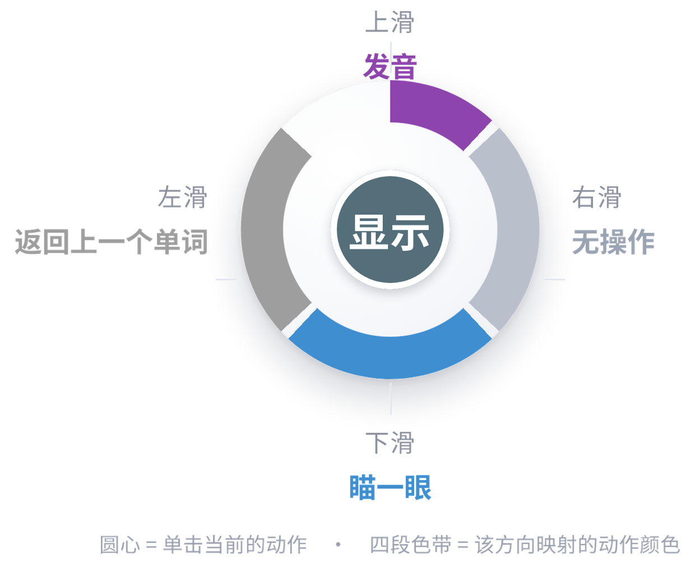
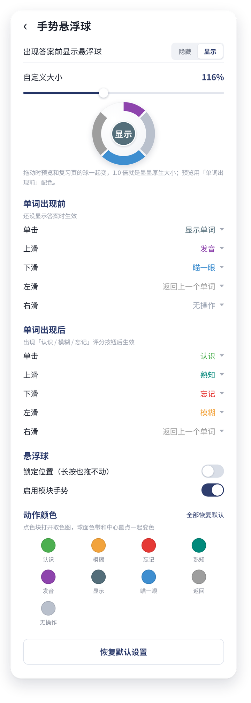
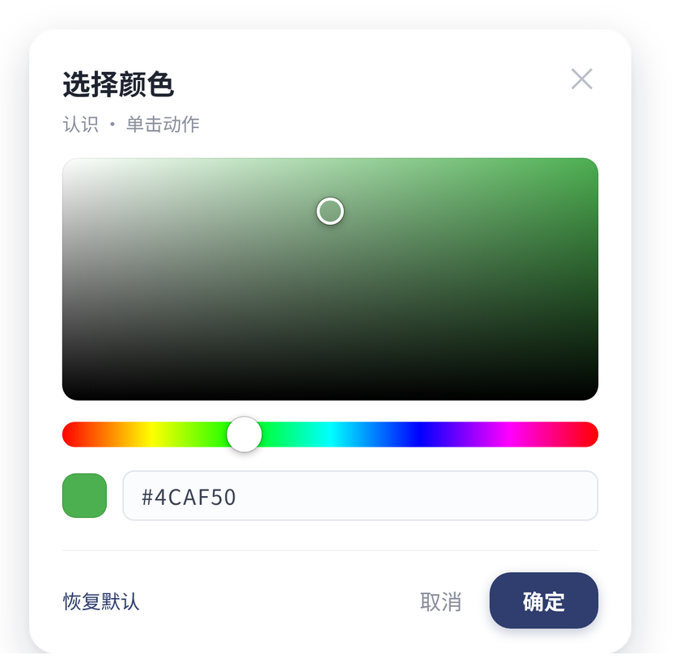

<div align="center">

<h1>墨墨复习悬浮球</h1>

<p><strong>让墨墨背单词自带的悬浮球，多出一套顺手的五向手势。</strong></p>

<p>球还是那颗球 · 动画、拖动、吸附全部原生 · 设置直接长在墨墨的设置页里</p>

<p>
  <a href="../../releases/latest"></a>
  
  
  
</p>

<p>
  <a href="../../releases/latest"><strong>下载最新版</strong></a>　·　<a href="#安装">安装</a>　·　<a href="#默认映射">默认映射</a>　·　<a href="#设置界面">设置界面</a>　·　<a href="#诊断">诊断</a>
</p>

</div>

<p align="center">
  
</p>

## 它接管的是哪颗球

不是再造一个球，而是接管墨墨复习页里那颗原生球（`rev_floating_btn` / `MMFloatingButton`）：

| 方面 | 说明 |
| --- | --- |
| **外观、按压动画、拖动跟手、边缘吸附** | 全部由墨墨原生处理，模块一概不碰 |
| **模块只做一件事** | 在手指抬起时判一次方向，命中就执行你的映射，同时补一个 `ACTION_CANCEL` 给原生，避免原生那套固定手势跟着触发 |
| **页面上** | 始终只有一颗球 |
| **桌面** | 没有图标；模块也没有任何 Activity / Service / Provider，只有 Xposed 入口 |

配置项不是独立 App，而是直接**并进墨墨「手势悬浮球」设置页**：整页（标题栏、插图、原生设置项、底部按钮）收进同一个滚动容器，模块的配置接在原生列表后面，从上到下就是一张完整设置页，不弹新页面。

## 功能

**手势**

- 单击、上滑、下滑、左滑、右滑五向可配，**单词出现前 / 出现后**两套独立映射。
- 动作按阶段给：出现前只有「显示单词 / 瞄一眼 / 发音 / 返回上一个单词 / 无操作」，出现后是「认识 / 模糊 / 忘记 / 熟知 / 发音 / 返回 / 无操作」，不会出现「答案没出来却选了认识」这种按了没反应的组合。
- 手势判定与「出现前 / 出现后」切换都是即时的：评分栏一出现，球面配色和中心文字立刻换，不用等轮询。

**球面**

- 沿轮廓的四段色带对应当前映射的动作颜色，中心圆点的底色就是「单击」的动作颜色——点之前就能看出会发生什么。
- 滑动时对应方向的弧线加粗、中心文字立刻变成该方向将执行的动作，抬手淡出。这段动画由模块自绘，不触发墨墨原有手势。
- 大小可调 **60%–200%**，设置页滑杆下方就是按同一画法实时缩放的预览球；拖动时复习页那颗球一起变。原生「悬浮球尺寸」会被收起，避免两个入口打架。
- 颜色可逐个动作自定义，取色图 + 色相条 + `#RRGGBB` 色值，改完立即生效。

**其他**

- 「底栏添加『熟知』按钮」默认开启：答案出现后底栏从三个变四个，不用去开「标识熟知」。
- 长按拖动、位置持久化都沿用墨墨原生行为；打开「锁定位置」后长按也拖不动。
- 设置页底部有「关于」：捐赠入口、项目地址、模块版本号。
- 诊断日志只存内存（最多 600 条），需要时才导出成文件（保留最近 10 份）。

## 默认映射

| 手势 | 单词出现前 | 单词出现后 |
| :---: | --- | --- |
| 单击 | 显示单词 | 认识 |
| 上滑 | 发音 | 熟知 |
| 下滑 | 瞄一眼 | 忘记 |
| 左滑 | 返回上一个单词 | 模糊 |
| 右滑 | 无操作 | 返回上一个单词 |

「单词出现前」指还没点开答案、页面提示「请回忆…点击屏幕显示答案」的阶段；出现「认识 / 模糊 / 忘记」评分按钮后即为「单词出现后」。

> **关于「熟知」**：墨墨默认底栏只有「认识 / 模糊 / 忘记」，「熟知」要么藏在「认识」的长按手势里（按住不动 → 上划到「标记熟知」），要么在 更多设置 → 复习页面 → 工具栏快捷 开「标识熟知」后出现在顶栏。
>
> 设置页的「底栏添加『熟知』按钮」**默认开启**：答案出现后，模块会照着「认识」的样式补一个「熟知」，插进「认识」和「模糊」之间，底栏变成四个——`认识 / 熟知 / 模糊 / 忘记`。底栏是 ConstraintLayout 的水平链，模块会把链拆开重新接上，所以四个按钮是真正的四等分，不是盖上去的浮层。
>
> 点这个「熟知」直接调墨墨自己的 `ReviewFragment.X0(ReviewResponse.WELL_FAMILIAR.value, false)`，和顶栏图标、长按上划是同一个入口；方法名对不上时自动退回「长按认识 → 上划」。
>
> 悬浮球滑「熟知」时，两个入口哪个在就用哪个：顶栏图标可见就点顶栏，否则用底栏这个按钮的同一套调用。关掉开关后底栏保持三个，悬浮球只尝试顶栏，找不到会提示手动上划。
>
> 墨墨翻页会重建操作栏，模块每 400ms 复查一次，按钮没了就补回去。相关日志：
>
> - `熟知：底栏已补上第四个按钮（ConstraintLayout）…` —— 插进去了，附带约束字段名；
> - `熟知：底栏按钮 300ms 后 …` —— 按钮最终尺寸和位置，能看出四等分有没有生效；
> - `熟知：已调用 ReviewFragment.X0(4, false)` —— 点按钮走的是原生应答链路；
> - `熟知：长按底栏「认识」 … 随后上划 Npx` —— X0 不可用时的兜底手势。

## 安装

1. 从 [Releases](../../releases/latest) 下载最新的 `momo-review-ball-*.apk` 安装。**桌面不会出现图标，这是正常的。**
2. 打开 LSPosed，在「模块」中启用 **墨墨复习悬浮球**。
3. 在模块的「作用域」中勾选 **墨墨背单词**。
4. 强制停止墨墨背单词（设置 → 应用 → 墨墨背单词 → 强行停止），再重新打开。
5. 进复习页，自带悬浮球即按默认映射生效。

> 已适配墨墨背单词 **5.5.25（846）** 与 **5.6.00（900）**。

## 设置界面

墨墨内进入 **设置 → 学习设置 → 手势悬浮球**，滑到底，模块的配置就接在原生设置项下面：

<p align="center">
  
</p>

<p align="center"><sub>设置页示意，实际以当前安装的版本为准；「导出诊断日志」「关于」位于更下方。</sub></p>

| 区块 | 内容 |
| --- | --- |
| **自定义大小** | 60%–200% 滑杆，1.0 倍即墨墨原生尺寸；下方预览球实时跟随 |
| **单词出现前** | 单击 / 上滑 / 下滑 / 左滑 / 右滑 五个下拉 |
| **单词出现后** | 同一组手势，另一套映射 |
| **悬浮球** | 锁定位置（长按也拖不动）、启用模块手势、底栏添加「熟知」按钮（三个变四个） |
| **动作颜色** | 九个动作各一个色块，点开取色图；「全部恢复默认」只清颜色 |
| **恢复默认设置** | 手势映射、尺寸、开关一起回到初始值 |
| **导出诊断日志** | 落成文本文件并复制到剪贴板 |
| **关于** | 捐赠支持、项目地址、模块版本号 |

> 该页面需要墨墨本身开启悬浮球功能；如果自带球没开，模块没有可接管的控件。

## 动作颜色

点任意色块打开取色器：

<p align="center">
  
</p>

- **颜色图**：上方是饱和度 / 明度面板，点哪里、拖到哪里，颜色就变到哪里；
- **色相条**：下方彩虹条决定基础色相；
- **颜色代码**：可以直接粘贴 `#RRGGBB`，`#AARRGGBB` 也识别（球面保持不透明，会自动补 `FF`）；
- **确定 / 取消 / 恢复默认**：只有点「确定」才保存；「恢复默认」先把取色器拨回默认色，仍需确认。

改完立即生效：复习页的四向色带、中心圆点、设置页预览球一起变色，不用重启墨墨。下拉框里的动作文字颜色也会同步；颜色太浅时自动换成深色文字，保证可读。

默认配色：认识绿、模糊橙、忘记红，熟知用**靛蓝 `#3B6EF6`**——原来的青绿 `#00897B` 和「认识」的绿太近，四个按钮并排时分不出来；换成靛蓝后绿 / 蓝 / 橙 / 红四个色相拉开，深色和浅色主题都清楚。

| 认识 | 模糊 | 忘记 | 熟知 | 发音 | 显示 | 瞄一眼 | 返回 | 无操作 |
| :---: | :---: | :---: | :---: | :---: | :---: | :---: | :---: | :---: |
| `#4CAF50` | `#F2A33C` | `#E53935` | `#3B6EF6` | `#8E44AD` | `#546E7A` | `#3E8ED0` | `#9E9E9E` | `#B9C0CC` |

## 「瞄一眼」

「瞄一眼」不是模块自绘的气泡，而是墨墨官方的**按住预览**：

> 答案出现前，手指按住悬浮球滑到位置、还不松手时，墨墨把例句顶出来；一松手立刻恢复。

模块在滑动越过阈值那一刻，就把官方「左滑」手势码交给墨墨自己的回调，例句随即出现；抬手立刻补官方收手码，例句立即收起。全程不画提示层、不复制业务逻辑，节奏和手指直接滑原生球一致。只在答案出现前可用。

## 诊断

设置面板里的「启用模块手势」开关关掉后，完全交还墨墨原生手势，方便对比。

日志只存在**内存环形缓冲**（最多 600 条），写满自动丢最早的，不会随使用时长一直涨；点「导出诊断日志」才落成文本文件（保留最近 10 份），同时复制到剪贴板。

也可以直接抓 logcat：

```bash
adb logcat -s MoMoBall
```

关键日志：

| 日志 | 含义 |
| --- | --- |
| `模块已注入 process=...` | LSPosed 已加载模块 |
| `已监听布局加载` | 已挂上 inflate 探测 |
| `已接管自带悬浮球，原有 listener=...` | 成功找到并接管自带球 |
| `已改为整页滚动：内容块=...` | 已把整页并进一个滚动容器（首选路径） |
| `已合并到页面滚动区，容器子项=...` | 页面本来就有滚动容器，已搬进去 |
| `已自建滚动区承载配置，top=... height=...` | 兜底：只把配置包进滚动容器 |
| `gesture=单击 已显示答案=false 动作=show 执行=true` | 手势识别与动作分发 |
| `悬浮球大小已应用：120%` | 自定义尺寸已作用到球控件 |
| `已隐藏原生「悬浮球尺寸」` | 原生尺寸项已收起，改用滑杆 |

动作无效时，日志会打印 `action not found: ... visible texts: [...]`，把那一行发出来即可定位。

## 原理与限制

- 墨墨使用梆梆加固（DexHelper）+ native 检测，业务方法静态分析不到。
- 模块通过 Hook `LayoutInflater.inflate`，在返回的视图树里按**资源 id 名** `rev_floating_btn` 找球，再设置 `OnTouchListener` 接管触摸。不依赖类名，加固和版本改版都不影响定位。
- 备用路径：Hook `MMFloatingButton` 的构造方法（类能被 classLoader 加载时生效）。
- 「答案已显示」沿用控件可见性判断：`rev_cl_operation_bar` 等评分控件真实可见即视为出现后。
- 动作执行等价于手动点按页面按钮，不修改墨墨 APK、不联网、不上传数据。
- 某个大版本若改了控件名，需要在 `FloatingButtonHook.ID_NAME` / `ActionExecutor` 里更新。

## 构建

GitHub Actions 自动构建：推送到 `main` 或手动运行 `build` workflow，产物在 Actions 的 Artifacts 中；打 `v*` 标签自动发布 Release，并在发布前清理更早的 Release，仓库始终只留最新一版。

本地构建（JDK 17 + Android SDK 34）：

```bash
./gradlew assembleRelease
```

Release 包使用仓库 Secrets 里的固定签名密钥（`KEYSTORE_BASE64`、`KEYSTORE_PASSWORD`、`KEY_ALIAS`、`KEY_PASSWORD`），保证后续版本能直接覆盖安装；fork 后未配置这些 Secrets 时会回退到 debug 签名。

> **发布策略**：仓库只保留最新一版 Release，旧版本会随新版本发布被清理；历史代码仍在 commit 记录里，需要旧版可自行 checkout 对应 tag 构建。

## 目录

```
app/src/main/java/com/fuoins/momoreviewball/
  ModuleEntry.java         LSPosed 入口
  FloatingButtonHook.java  定位并接管墨墨自带悬浮球
  SettingsInjector.java    把配置项并入墨墨手势设置页
  SettingsPanel.java       模块设置面板
  ActionExecutor.java      查找页面控件并执行动作
  BallPainter.java         球面画法（真球与预览共用）
  BallPreview.java         设置页里的实时预览球
  ColorPickerDialog.java   取色器
  Config.java              配置模型（读写进程内 SharedPreferences）
  Diag.java                内存日志 + 导出
  Util.java                通用工具
  XposedLog.java           日志包装
```

## 免责声明

仅供个人学习与自用，请遵守墨墨背单词的用户协议。项目与墨墨官方无关。
